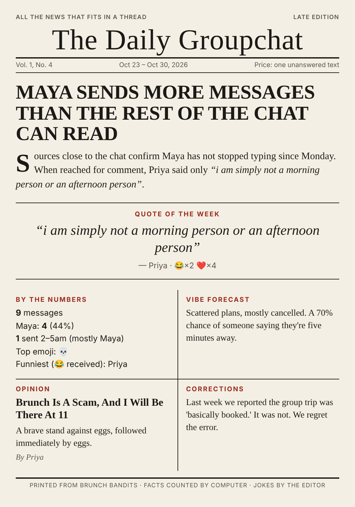

# The Daily Groupchat

Turns a week of an Apple Messages group chat into a one-page satirical newspaper, as a PNG
you can post back into the chat.



- **Facts come from code.** Message counts, the 2–5am crowd, top emoji and reaction counts
  are computed from the Messages database, never written by the model.
- **Quotes are real.** Every quote Claude uses is checked word for word against what that
  person actually sent. Made-up quotes are dropped.
- **Kind roasts.** The prompt keeps health, relationships, money and anything private off
  limits, and you look at every issue before it goes anywhere.

Runs on your Mac only. It reads `~/Library/Messages/chat.db` (a copy, read-only) and
sends the week's messages, with names instead of phone numbers, to the Claude API to write
the jokes. Ask your group first.

The plan behind it is in [`docs/designs/daily-groupchat.md`](../docs/designs/daily-groupchat.md).
This folder is step 1 and step 2 of that plan: the test scripts and the pipeline you run by
hand. The Sunday automation comes after the test scripts are run on a real Mac.

## Setup (on your Mac)

1. **Install** (Python 3.9+):

   ```bash
   cd daily-groupchat
   python3 -m venv .venv && source .venv/bin/activate
   pip install -r requirements.txt
   python -m playwright install chromium
   ```

2. **Give your terminal Full Disk Access** so it can read Messages: System Settings →
   Privacy & Security → Full Disk Access → turn on Terminal (or iTerm, etc.). Then open a
   new terminal window.

3. **Pick the chat:**

   ```bash
   python -m groupchat chats
   cp config.example.toml config.toml   # paste the chat's GUID into chat_guid
   cp names.example.json names.json     # phone numbers / emails -> names
   ```

4. **Set your API key** (or run `ant auth login`):

   ```bash
   export ANTHROPIC_API_KEY="your-api-key-here"
   ```

## Usage

```bash
python -m groupchat peek                 # who talked most + the most-loved messages (no API call)
python -m groupchat issue --sample       # render a canned issue from your real stats (no API call)
python -m groupchat issue                # write this week's issue with Claude -> issues/<date>-v1.png
python -m groupchat issue --version 2 --notes "less mean to Dana"   # rewrite with editor's notes
python -m groupchat mark-posted issues/<date>-v2.json               # after you post it
```

`mark-posted` keeps the issue numbers going (Vol. 1, No. 2 ...) and lets next week's
Corrections column call back to the last issue you actually posted.

`config.toml`, `names.json` and `issues/` hold personal data and are git-ignored.

## The three tests from the plan (run these first)

These decide how the Sunday automation gets built. Send Claude what they print.

| Test | Command | What you're checking |
|---|---|---|
| (a) Can a script send an image? | `./spikes/send_image.sh "<your number>" sample-issue.png` | The text **and** the image arrive on your phone |
| (b) Can we read the chat? | `python -m groupchat peek` | Messages look right, few rows skipped, reactions counted |
| (c) How do texts to yourself look? | `python -m groupchat chats --all` to find your chat with yourself, text yourself "ship" from your phone, then `python -m groupchat rows --chat "<that GUID>"` | Whether each message shows up once or twice, and with which `from_me` value |

Test (b) is also the Assignment from the plan: the "Most-loved messages" list is last
week's most-tapbacked messages.

## Tests

```bash
python -m pytest -q
```

The tests build a fake `chat.db` with the real database's quirks: text stored only in
`attributedBody`, edited and unsent messages, tapbacks that get added and removed, group
events and attachment-only rows. Set `GROUPCHAT_RENDER_TEST=1` to also render a real PNG.
If Playwright's own browser isn't installed, point `GROUPCHAT_CHROMIUM` at a Chrome or
Chromium binary.
